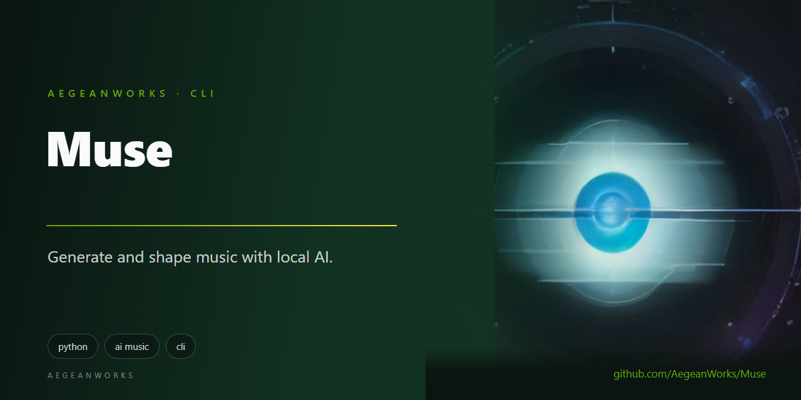

# muse

<!-- aegean:media:start -->
<p align="center"></p>
<p align="center"><a href="LICENSE"></a> <a href="https://github.com/AegeanWorks/AIKit"></a></p>
<!-- aegean:media:end -->


Prompt-driven AI music creation with an automated listener that scores how well each track fits the theme and can retry using the judge's own suggestions, exposed as a CLI (single tracks or a JSON batch) and Python library.

## ⚡ 30-Second Cold-Start Quick Reference

- **Runtime Prerequisites**: Python 3.10+ (standard library only; nothing to `pip install`) and network access for the hosted providers.
- **Try it offline** (no keys, writes a short test tone):
  ```bash
  python -m muse generate "dark cave drones" --theme "cave level" --provider mock --judge mock
  ```
- **Real generation and judging**:
  ```powershell
  $env:REPLICATE_API_TOKEN = "<your token>"
  $env:GEMINI_API_KEY = "<your key>"
  python -m muse generate "tense low drones, slow heartbeat, metallic scrapes" --theme "abandoned mine level" --duration 45 --name mine-theme
  ```
- **Retry until it fits** (each take is billed):
  ```bash
  python -m muse generate "tense low drones" --theme "abandoned mine level" --duration 45 --attempts 3
  ```
  A rejected take is re-rendered with the judge's suggestions appended to the prompt; the best-scoring take is returned and every take stays in its own folder.
- **A whole soundtrack** from one manifest:
  ```bash
  python -m muse batch tracks.json --attempts 2 --strict
  ```
- **Canonical Regression Shield Gate**:
  ```bash
  python -m unittest discover -s tests -t .
  ```

### 🛠️ AIKit Commands (run from the AIKit folder)
| Role | Command |
|---|---|
| Status, task and gates | `python aikit.py status muse` |
| Phase 4: every gate | `python aikit.py check muse` |
| Repair memory and map, then check | `python aikit.py fix muse` |
| Resume an interrupted task | `python aikit.py resume muse` |

## What it does

1. A **provider** renders your prompt into audio (default: `stability-ai/stable-audio-2.5` on Replicate).
2. A **judge** listens to the rendered file with Gemini and returns a schema-checked verdict: a 0-100 fit score, a verdict, strengths, issues and concrete prompt suggestions. A required judge is built before the first render, so a missing judge key fails without spending a prediction.
3. The pipeline writes the audio plus `muse.json` evidence (request, model, settings, verdict) into `output/<slug>/`, so any project can ship a track together with the reason it was accepted.
4. With `--attempts N`, a take below the threshold is retried: the judge's suggestions are appended to the prompt, another take is rendered and judged, and the loop stops on acceptance, when the judge offers nothing actionable, or after `N` takes. The best-scoring take is returned.
5. `muse list` reads that evidence back and reports scores, verdicts and missing audio without calling any provider; `muse show` prints one artifact's full verdict, suggestions, attempts and settings.

If the score is below the threshold the track is still kept, but `accepted` is `false`. Use `--strict` in automation to fail the command instead. With several attempts, `--strict` judges the best take.

`muse batch` runs the same provider, judge and retry loop over a JSON manifest, one track at a time, and prints a set-level summary.

## Command line

```bash
# generate + judge, human-readable report
python -m muse generate "warm analog pads with a hopeful motif" --theme "village at dawn" --duration 40

# machine-readable output for an agent or build script
python -m muse generate "glitchy percussion, rising tension" --theme "boss phase two" --duration 30 --json

# listen to an existing file
python -m muse judge output/boss-phase-two/track.wav --theme "boss phase two" --prompt "glitchy percussion"

# retry a rejected take with the judge's suggestions, keeping the best result
python -m muse generate "glitchy percussion" --theme "boss phase two" --attempts 3

# render a whole soundtrack from one manifest, failing CI if any track is rejected
python -m muse batch tracks.json --attempts 2 --strict --json

# after a failure, reuse accepted tracks and retry the rest
python -m muse batch tracks.json --resume --keep-going

# inspect the plan without calling a provider or judge
python -m muse batch tracks.json --dry-run --json

# preview which tracks --resume would reuse or retry
python -m muse batch tracks.json --dry-run --resume

# review scored evidence, newest first
python -m muse list --accepted-only --limit 10
python -m muse list --match "cave" --sort score
python -m muse list --json

# inspect one artifact's full evidence, or print raw metadata
python -m muse show cave-level
python -m muse show cave-level --json

# what is wired in?
python -m muse providers
```

| Flag | Meaning |
|---|---|
| `--theme TEXT` | Project theme the track must serve; defaults to the prompt for judging |
| `--duration SECONDS` | Requested length, up to 190 |
| `--name TEXT` | Artifact folder name (default: theme or prompt slug) |
| `--attempts N` | Render up to `N` takes (1-5, default 1), refining the prompt with the previous verdict's suggestions |
| `--out DIR` | Artifact root (default: `output/`) |
| `--provider NAME` | `replicate` (default) or `mock` |
| `--model SLUG` | Replicate model, e.g. `meta/musicgen` for 30-second clips |
| `--judge NAME` | `gemini` (default), `mock`, or `none` |
| `--judge-model NAME` | Judge model, default `gemini-2.5-flash` |
| `--min-score N` | Acceptance threshold 0-100, default 60 |
| `--strict` | Exit 1 when the verdict is missing or below the threshold |
| `--allow-unjudged` | Keep audio, metadata and exit 0 when the judge cannot be built or fails |
| `--json` | Print a machine-readable result |

Exit codes: `0` success, `1` operational failure (with `Why:` and `Fix:`), `2` argument misuse.

### Batch mode

`muse batch` reads one UTF-8 JSON manifest (maximum 1 MB and 50 tracks) and renders every entry
with the same provider, judge and `--attempts` setting:

```json
{
  "tracks": [
    {"name": "village-dawn", "prompt": "warm analog pads", "theme": "village at dawn", "duration": 40},
    {"name": "boss-phase-two", "prompt": "glitchy percussion", "theme": "boss phase two", "duration": 30}
  ]
}
```

`prompt` is required; `theme`, `duration` and `name` are optional and default to the same values
as `generate`. Unknown keys, wrong types, an empty track list and more than 50 tracks are rejected
with a `Why:` and `Fix:`. Batch needs a listening judge when any track must render, and runs
sequentially; a fully accepted `--resume` reuses evidence without one.

`--dry-run` validates the same manifest and prints the track plan, provider, judge and output
root without calling either service or writing artifacts or state. It also accepts `--judge none`,
because no listening happens. With `--resume` it reads the saved state and marks each track
`reuse` or `render`, with the reason (new, previous rejection/failure, or missing evidence); the
JSON plan adds `resume`, `action`, `reason`, `previous_status` and `previous_score` per track.

Each run writes a hidden `<out>/.muse-batch-<hash>.json` state file after every track. The hash
covers the validated manifest, so changing a prompt, theme, duration or name starts a different
state; provider and judge flags are not part of the hash, so run without `--resume` to re-judge
with a different model. Resume expects the same `--out` and working directory, because evidence
paths are stored as rendered. `--resume` requires that state, reuses accepted tracks whose audio
and `muse.json` still exist, and rerenders rejected or failed tracks; missing evidence is reported
and rerendered.
`--keep-going` records a failure and continues with the rest of the manifest; without it the first
failure is recorded and the command stops. A failed track always exits `1`; `--strict` also exits
`1` when any track is rejected. `--json` prints a `tracks` array plus `total`, `accepted`,
`rejected`, `failed` and `reused` counts, with a `reused` flag on every track.

| Batch flag | Meaning |
|---|---|
| `--dry-run` | Validate and print the plan; with `--resume`, preview reuse/retry; no writes or calls |
| `--resume` | Reuse accepted tracks from the saved batch state; rejected and failed tracks rerender |
| `--keep-going` | Record a failed track and continue with the rest |
| `--strict` | Exit 1 when any track is rejected (failures always exit 1) |

To start a batch over from scratch, run without `--resume`; that replaces the state file but keeps
the old artifact folders as evidence.

### Catalog

`muse list` scans one level of `<out>` for `muse.json`, shows the newest evidence first, and marks
tracks whose audio file is missing. `--accepted-only` hides rejected tracks, `--match TEXT` filters
name, prompt and theme case-insensitively, `--sort date|score|name` orders the result (date is
newest first), `--limit N` caps it (default 20), and `--json` prints the same fields as a
machine-readable `artifacts` array (folder, name, prompt, theme, duration, score, verdict, accepted,
attempts, paths and `audio_exists`). It is read-only and never calls a provider. Corrupt, oversized
or unsupported metadata is reported on stderr and skipped instead of failing the whole listing.

`muse show <folder|muse.json|track-file>` resolves one artifact under `--out` (or from a path) and
prints its prompt, theme, track, score, summary, strengths, issues, suggestions, attempts and
settings. `--json` prints the raw `muse.json` object instead; `show` writes nothing.

## Python library

```python
from muse import MuseConfig, MusicRequest, compose

result = compose(
    MusicRequest(
        prompt="slow cello ostinato, sparse piano, rain texture",
        theme="melancholy title screen",
        duration=60,
        name="title-theme",
    ),
    MuseConfig.from_env(),
    max_attempts=3,
)
print(result.track.path)          # output/title-theme/track.wav
print(result.verdict.score)       # 84
print(result.accepted)            # True
print(result.metadata_path)       # output/title-theme/muse.json
print(len(result.attempts))       # 2, every take in order
print(result.attempts[0].score)   # 52, the rejected first take
```

`compose` stops as soon as a take is accepted, when the verdict has no suggestions, or at
`max_attempts` (maximum 5). The returned result describes the best-scoring take, while
`result.attempts` keeps every take with its prompt, verdict and artifact paths.

Batch manifests are validated by `muse.batch.load_manifest`, which returns `MusicRequest` objects
for a library to loop over; the CLI batch command is a thin orchestrator around that loader.

Judging only:

```python
from muse import MusicRequest, Track, judge_track

track = Track(path=..., provider="file", model="local", duration_seconds=42,
              prompt="...", theme="...")
verdict = judge_track(track, MusicRequest("...", theme="...", duration=42))
```

Providers and judges are protocols (`muse.providers.base.MusicProvider`,
`muse.judges.base.MusicJudge`). Add an adapter, register it in the matching registry, and the
CLI and pipeline pick it up without further changes.

## Configuration

Set these once in your shell or CI secrets; keys are read from the environment only and are
never written into artifacts.

| Variable | Default | Purpose |
|---|---|---|
| `REPLICATE_API_TOKEN` | required | Replicate access for music generation |
| `GEMINI_API_KEY` | required | Gemini access for listening |
| `MUSE_OUTPUT_DIR` | `output` | Artifact root |
| `MUSE_PROVIDER` | `replicate` | Default provider |
| `MUSE_JUDGE` | `gemini` | Default judge, or `none` |
| `MUSE_MUSIC_MODEL` | `stability-ai/stable-audio-2.5` | Replicate model slug |
| `MUSE_REPLICATE_VERSION` | unset | Pin a community model version hash |
| `MUSE_JUDGE_MODEL` | `gemini-2.5-flash` | Gemini model with audio input |
| `MUSE_MIN_SCORE` | `60` | Acceptance threshold |
| `MUSE_HTTP_TIMEOUT` | `120` | Per-request timeout in seconds |
| `MUSE_POLL_TIMEOUT` | `600` | Maximum wait for a prediction |

Default model notes:

- `stability-ai/stable-audio-2.5` renders up to 190 seconds from a prompt and duration, and returns mp3.
- `meta/musicgen` is a cheaper short-clip option that can return wav or mp3: `--model meta/musicgen`.
- If a community model needs a version hash instead of the official model endpoint, set
  `MUSE_REPLICATE_VERSION`; the provider then posts to `/v1/predictions`.
- Model-specific knobs (`steps`, `cfg_scale`, `seed`, `model_version`, ...) go through
  `MusicRequest.extra` in the library; only prompt and duration are sent by default.
- Replicate bills per prediction and Gemini bills audio input tokens. Duration is the main cost lever; `--attempts N` multiplies both by the number of takes actually rendered, and a batch multiplies again by its track count. `--resume` avoids paying again for accepted tracks.

## Artifacts

```text
output/<slug>/
├── track.wav        <- rendered audio (or .mp3 when the model returns mp3)
└── muse.json        <- schema 2: attempt, request, model, settings, verdict, accepted, judge_error
output/<slug>-2/     <- second take of an --attempts run, same files
output/.muse-batch-<hash>.json  <- batch resume state, not track evidence
```

Each take keeps its own folder, including rejected ones, so the full retry history is auditable.
The selected take's `muse.json` also records `selected_attempt` and an `attempts` array with the
prompt, score, verdict and relative artifact paths of every take. Batch runs use the same per-track
folders plus the hidden fingerprint state file, which stores summaries only; `--resume` checks that
the referenced audio and `muse.json` still exist before reusing a track.

`muse.json` is written atomically (temporary file, fsync, replace), so an interrupted run never
leaves truncated metadata. Repeated runs with the same name get `-2`, `-3`, ... folders instead
of overwriting earlier evidence. If a required judge fails, the audio and a `muse.json` recording
`judge_error` are kept for inspection and the command exits `1`; a failed render removes its
empty run folder.

## What's Inside

```text
muse/
├── pyproject.toml            <- zero-dependency packaging, `muse` console script
├── .gitignore                <- generated output and transient state excluded
├── LICENSE                   <- Aegean License 1.1 (AL-1.1): free personal use
├── LICENSES/                 <- REUSE license texts
├── REUSE.toml                <- Machine-readable SPDX metadata
├── COMMERCIAL.md             <- Commercial licensing terms
├── README.md
├── assets/
├── muse/
│   ├── __init__.py           <- public API: compose, judge_track, types, config
│   ├── __main__.py           <- `python -m muse`
│   ├── artifacts.py          <- unique run folders, atomic JSON
│   ├── audio.py              <- WAV duration, MIME sniffing, offline tone
│   ├── batch.py              <- JSON manifest parsing and validation
│   ├── batch_state.py        <- fingerprinted, crash-safe batch progress
│   ├── catalog.py            <- read-only artifact evidence discovery
│   ├── cli.py                <- generate / batch / judge / list / show / providers commands
│   ├── config.py             <- environment, defaults, secret access
│   ├── errors.py             <- What / Why / Fix failures
│   ├── net.py                <- JSON + download HTTP client with retry and timeout
│   ├── pipeline.py           <- render, listen, refine, persist evidence
│   ├── types.py              <- frozen request, track, verdict, result
│   ├── judges/
│   │   ├── base.py           <- listening protocol
│   │   ├── gemini.py         <- audio judge via Gemini
│   │   ├── mock.py           <- deterministic offline judge
│   │   └── registry.py       <- name-to-judge lookup
│   └── providers/
│       ├── base.py           <- generation protocol
│       ├── mock.py           <- offline sine tone
│       ├── replicate.py      <- hosted model adapter
│       └── registry.py       <- name-to-provider lookup
├── tests/                    <- 174 offline unit tests, no network or keys
└── .aikit/                   <- this project's memory: ledger, decisions
```

## Testing

```bash
python -m unittest discover -s tests -t .
```

The suite never calls the network: Replicate and Gemini are replaced with in-process fake
transports, and the mock provider writes a real (short) WAV file. Cost-free end-to-end check:

```bash
python -m muse generate "cave drones" --theme "cave level" --provider mock --judge mock --json
```

## Troubleshooting

| Symptom | Cause | Fix |
|---|---|---|
| `REPLICATE_API_TOKEN is not set` | key missing | export the token in the current shell or CI secrets |
| `the service returned HTTP 401/403` | invalid or expired key | rotate the key; never commit it |
| `Replicate did not finish within ...` | long render or queue | raise `MUSE_POLL_TIMEOUT` or shorten `--duration` |
| `Replicate did not return a prediction handle` | wrong model slug or a community model without a version | use an official slug or set `MUSE_REPLICATE_VERSION` |
| `the track is too large for the Gemini audio judge` | inline audio exceeds 14 MB (base64 adds a third) | shorten `--duration` |
| `the judge returned an invalid score` | model drifted from the schema | retry, or switch `MUSE_JUDGE_MODEL` |
| `unknown music provider` / `unknown judge` | typo | run `python -m muse providers` |
| `attempts need a listening judge` | `--attempts` above 1 with `--judge none` | omit `--attempts`, or use `gemini`/`mock` |
| `batch needs a listening judge` | `muse batch --judge none` | omit `--judge none`; a batch cannot report acceptance without a verdict |
| `the batch manifest ...` | missing file, invalid JSON, unknown keys or bad types | read the `Why:`/`Fix:` lines; the manifest needs a `tracks` array of prompt objects |
| `no batch state to resume` | `--resume` before any batch ran, or a changed `--out` | run without `--resume`, or point `--out` at the previous artifact root |
| `the batch state belongs to a different manifest` | a prompt, theme, duration or name changed | restore the manifest, or run without `--resume` for a fresh batch |
| `Warning: .../muse.json: ...` | corrupt, oversized or unsupported evidence | `muse list` skips it; repair or remove that artifact folder |

<!-- aegean:brand-assets:start -->
## 🎨 Brand Assets

> **AI-Generated Brand Artwork.** The banner and logo are **AI-generated brand assets**. They are illustrative and may not literally depict every feature or the full project scope.
<!-- aegean:brand-assets:end -->

## 📜 License

Free for personal use under the Aegean License 1.1 (AL-1.1); see [LICENSE](LICENSE). Any commercial use needs the Aegean Commercial License 1.0 (ACL-1.0); see [COMMERCIAL.md](COMMERCIAL.md).
